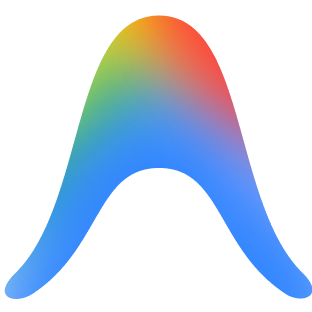

# AIQuotaBar

<p align="center">
  
  &nbsp;&nbsp;
  
  &nbsp;&nbsp;
  
</p>

<p align="center">
  <strong>Lightweight, frameless native macOS menu bar quota tracker for Claude, Antigravity, and Codex.</strong><br/>
  Zero Electron bloat · 100% local & private · Native SwiftUI + AppKit
</p>

---

## ✨ Features

- **Frameless Native Menu Bar View**: Sits cleanly in your macOS menu bar with official provider logos and color-coded **remaining** quota percentages (`100% → 0%`):
  - 🟢 **Green** (`> 40%` remaining)
  - 🟡 **Yellow** (`16% – 40%` remaining)
  - 🔴 **Red** (`≤ 15%` remaining)
- **Pin Any Quota Bucket (`📌`)**: Click any `5h`, `7d`, or `30d` pill inside the dropdown popover to pin or unpin it from your menu bar while still seeing all enabled providers inside the popover.
- **App-Level Provider Toggles (`⚙️`)**: Enable or disable **Claude**, **Antigravity** (with an optional toggle for Claude models inside Antigravity), or **Codex** individually if you only use a subset of tools.
- **Launch at Login**: One-click toggle in the `⚙️` settings drawer.

---

## 🚀 Install via Homebrew

```bash
brew tap nikhilhassija/tap
brew install --cask ai-quota-bar
open -a AIQuotaBar
```

Or install in a single line without tapping first:

```bash
brew install --cask nikhilhassija/tap/ai-quota-bar
```

### Updating to the Latest Version

```bash
brew update && brew upgrade --cask ai-quota-bar
```

---

## 🔒 How It Works (100% On-Device)

`AIQuotaBar` never sends your credentials or usage data to any third-party server. Every quota check happens directly on your Mac using your existing local desktop sessions:

| Provider | Source | Windows Tracked |
| :--- | :--- | :--- |
| **Claude** | Reads local session from **Claude Code** Keychain (`Claude Code-credentials`) or **Claude Desktop** (`~/Library/Application Support/Claude/config.json` + `Claude Safe Storage` Keychain) to query `api.anthropic.com/api/oauth/usage` directly, with fallback to local JSONL session logs (`~/.claude/projects`). | `5h` session window & `7d` weekly window |
| **Antigravity** | Auto-discovers the running local Antigravity `language_server_macos_*` process port & CSRF token on `127.0.0.1` (`GetUserStatus`). | `5h` rolling window & `7d` weekly window |
| **Codex** | Reads your local `~/.codex/auth.json` token or latest rate-limit headers in `~/.codex/sessions/**/rollout-*.jsonl`. | `5h` / `7d` / `30d` plan windows |

---

## 🛠️ Build & Release from Source

Requires macOS 13.0+ (Ventura or newer) and Xcode Command Line Tools (`swiftc`).

```bash
# Build native .app bundle into ./build/AIQuotaBar.app
./build.sh
open build/AIQuotaBar.app
```

### Publishing a New Release to Your Homebrew Tap

```bash
# Compiles AIQuotaBar.app, packages dist/AIQuotaBar.zip, and updates SHA256 in Casks/ai-quota-bar.rb
./release.sh 1.0.0

# Create a GitHub Release with the zip attached
gh release create v1.0.0 dist/AIQuotaBar.zip --title "v1.0.0" --notes "AIQuotaBar v1.0.0"
```

Then copy the updated [`Casks/ai-quota-bar.rb`](Casks/ai-quota-bar.rb) into your `homebrew-tap` repository under `Casks/ai-quota-bar.rb`.

---

## 🌐 Interactive Demo & Landing Page

An interactive web demo is included in [`docs/index.html`](docs/index.html).  
To host it for free on **GitHub Pages**:
1. Go to your repository on GitHub → **Settings** → **Pages**.
2. Under **Build and deployment**, select **Deploy from a branch**.
3. Choose branch `main` and folder `/docs`, then click **Save**.
